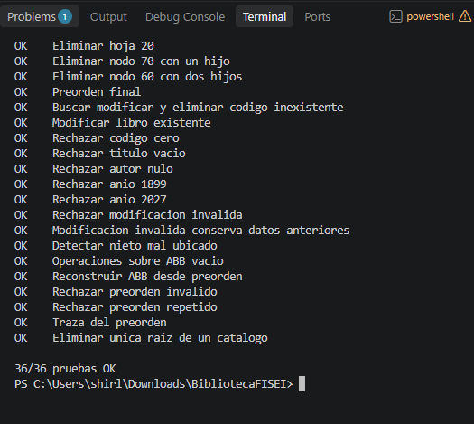

# Catálogo de la Biblioteca FISEI

Aplicación de consola en Java que utiliza un árbol general n-ario para organizar la biblioteca y un Árbol Binario de Búsqueda (ABB) para almacenar los libros de cada estante.

## Datos generales

- Estudiante: Yanchatipan Moreta Shirley Micaela.
- Asignatura: Estructura de Datos.
- Nivel: Tercero B.
- Actividad: APE 3, práctica individual.

## Descripción del problema

La Biblioteca FISEI se organiza en áreas y cada área contiene estantes. Esta jerarquía se representa mediante un árbol general.

Cada estante dispone de un ABB independiente, ordenado por el código de sus libros. Los códigos deben ser enteros positivos y no pueden repetirse dentro del mismo catálogo.

## Estructura del proyecto

| Paquete | Clases |
|---|---|
| enums | TipoUnidad, TipoRecorrido |
| modelo | Libro, UnidadBiblioteca |
| negocio | NodoUnidad, NodoLibro, ArbolBiblioteca, CatalogoABB |
| app | Main, DatosPrueba, PruebasBiblioteca, TrazasPersonales |

## Requisitos

- JDK 17 o posterior.
- Visual Studio Code con Extension Pack for Java, o una terminal con Java disponible.

## Compilación y ejecución

Abrir una terminal PowerShell en la carpeta principal del proyecto y ejecutar:

```powershell
New-Item -ItemType Directory -Force out

Get-ChildItem -Recurse src -Filter *.java | ForEach-Object { $_.FullName } | Set-Content fuentes.txt

javac -encoding UTF-8 -d out '@fuentes.txt'
```

Ejecutar el menú:

```powershell
java -cp out app.Main
```

Ejecutar las pruebas:

```powershell
java -cp out app.PruebasBiblioteca
```

Comprobar las trazas personales:

```powershell
java -cp out app.TrazasPersonales 2004
```

## Estructura inicial

La biblioteca contiene las áreas Software, Tecnologías de la Información y Telecomunicaciones.

| Estante | Códigos en orden de inserción |
|---|---|
| SW-E1 | 60, 35, 80, 20, 45, 70, 90, 40, 75 |
| SW-E2 | 15, 10, 25 |
| TI-E1 | 50 |

Características del árbol general:

- Unidades: 7.
- Hojas: 4.
- Altura: 2 aristas.
- Total de libros: 13.

TEL es una hoja porque no tiene hijos, aunque su tipo sea AREA.

## Funciones del menú

| Opción | Función |
|---:|---|
| 1 | Cargar la estructura inicial |
| 2 | Mostrar la jerarquía |
| 3 | Agregar una unidad |
| 4 | Buscar una unidad |
| 5 | Consultar estadísticas y nivel |
| 6 | Insertar un libro |
| 7 | Buscar un libro |
| 8 | Modificar un libro |
| 9 | Eliminar un libro |
| 10 | Mostrar recorrido y traza |
| 11 | Ejecutar retos del ABB |
| 12 | Ejecutar pruebas |
| 13 | Comprobar trazas personales |
| 0 | Salir |

La aplicación inicia solo con la raíz BIB. La opción 1 carga la estructura inicial y reinicia los cambios anteriores.

Las opciones 12 y 13 utilizan estructuras independientes y no modifican los datos del menú.

## Operaciones implementadas

### Árbol general

Inserción de unidades respetando la jerarquía BIBLIOTECA → AREA → ESTANTE, búsqueda sin distinguir mayúsculas, cálculo de altura, conteo de hojas, consulta de nivel, visualización en preorden y conteo total de libros.

### Catálogo ABB

Inserción sin códigos repetidos, búsqueda, conteo, modificación y eliminación de libros.

La eliminación contempla nodos hoja, nodos con un hijo y nodos con dos hijos. En el último caso se utiliza el sucesor inorden.

Se implementan los recorridos preorden, inorden y posorden con sus trazas recursivas.

### Retos

- Conteo en rango inclusivo con poda.
- Camino de búsqueda.
- Validación del ABB mediante límites mínimos y máximos.
- Reconstrucción desde preorden sin insertar los códigos uno por uno.

Las operaciones de los árboles se implementan con recursividad y no utilizan estructuras ordenadas ni métodos de ordenamiento.

## Resultados de las pruebas

La clase PruebasBiblioteca ejecuta 36 verificaciones.

Resultado obtenido:

```text
36/36 pruebas OK
```



## Trazas personales

Con los dígitos 2004 se forman los pares 20, 00 y 04.

- 20 se convierte en 21 porque ya existe en SW-E1.
- 00 se convierte en 1 porque el código debe ser positivo.
- 04 corresponde al código 4 y no requiere ajustes.

Los códigos personales son 21, 1 y 4.

La resolución con diagramas, recorridos, traza y eliminaciones se encuentra en [TRAZAS.md](TRAZAS.md).

## Consideraciones

- El código de un libro no se modifica.
- El año debe estar entre 1900 y 2026.
- Título y autor son obligatorios.
- Los títulos y autores de la carga inicial son datos de ejemplo.
- La altura se mide en aristas y la raíz se encuentra en el nivel 0.
- En un ABB sin balanceo, insertar códigos ordenados puede formar una cadena y llevar las búsquedas a O(n).