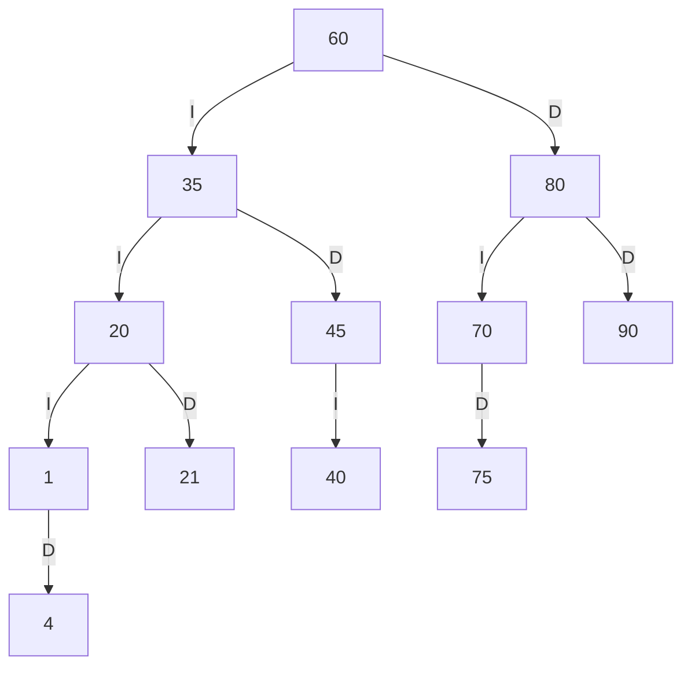
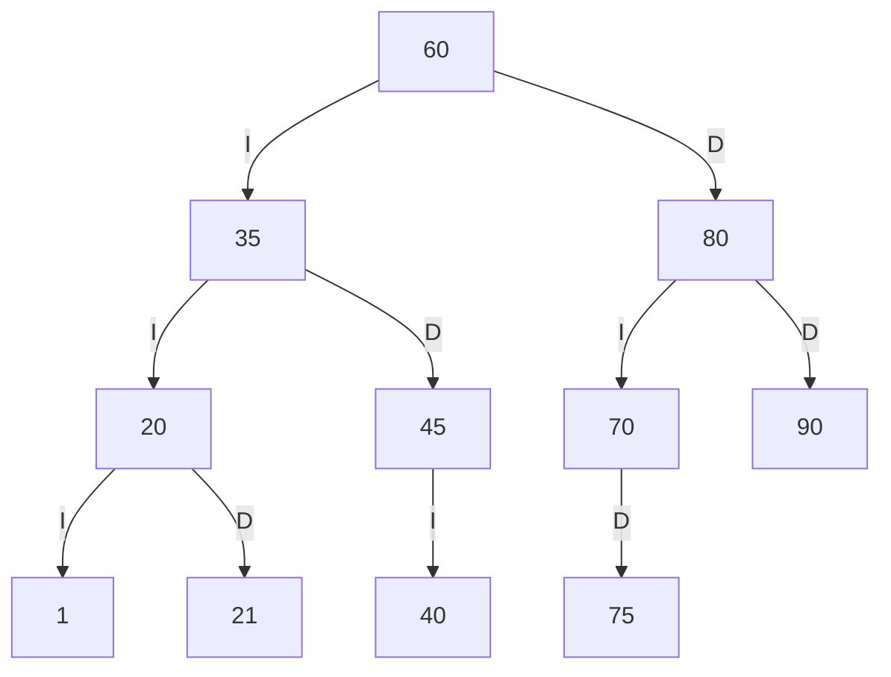
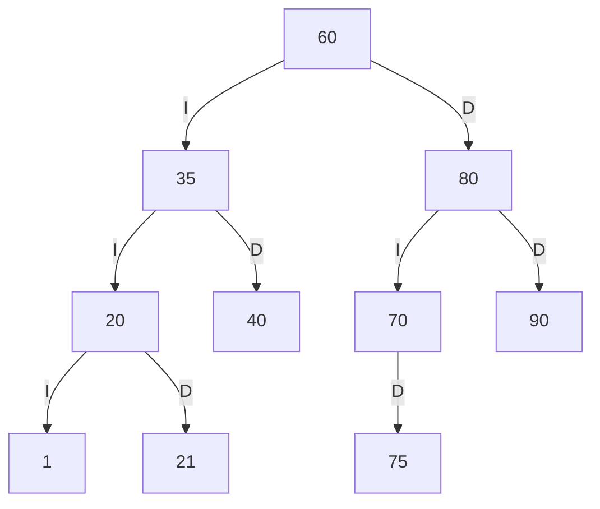
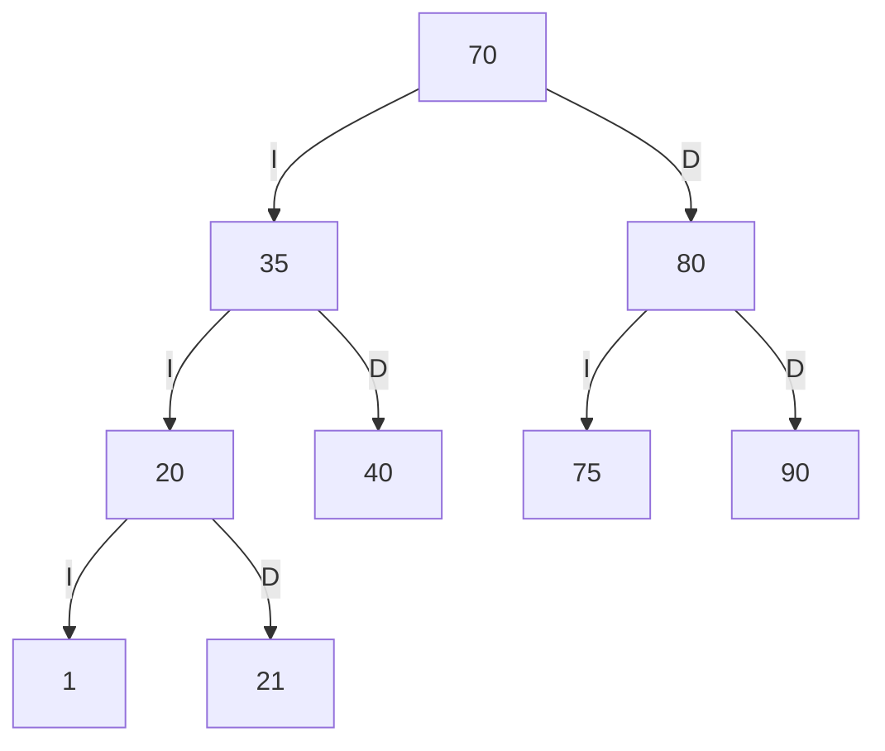

# Trazas personales del catálogo SW-E1

## 1. Cálculo de códigos personales

Últimos cuatro dígitos: 2004.

Por tanto: a = 2, b = 0, c = 0 y d = 4.

| Par | Valor inicial | Ajuste | Código final |
|---|---:|---|---:|
| ab | 20 | Ya existe en SW-E1; se suma 1 | 21 |
| bc | 00 | Cero no es válido; se suma 1 | 1 |
| cd | 04 | Es positivo y no existe | 4 |

Códigos personales: **21, 1 y 4**.

## 2. Secuencia de inserción

Primero se insertan los códigos iniciales de SW-E1:

60, 35, 80, 20, 45, 70, 90, 40, 75.

Después se insertan los códigos personales:

21, 1, 4.

Ubicación de las nuevas inserciones:

- 21: se compara con 60, 35 y 20; queda a la derecha de 20.
- 1: se compara con 60, 35 y 20; queda a la izquierda de 20.
- 4: se compara con 60, 35, 20 y 1; queda a la derecha de 1.

## 3. ABB después de insertar

Las aristas I indican hijo izquierdo y las aristas D, hijo derecho.



## 4. Tres recorridos

### Preorden

Orden: raíz, izquierda y derecha.

```text
60 35 20 1 4 21 45 40 80 70 75 90
```

### Inorden

Orden: izquierda, raíz y derecha.

```text
1 4 20 21 35 40 45 60 70 75 80 90
```

### Posorden

Orden: izquierda, derecha y raíz.

```text
4 1 21 20 40 45 35 75 70 90 80 60
```

Los tres recorridos coinciden con la salida de la opción 13 del programa al ingresar 2004.

## 5. Traza del preorden

```text
entra 60
VISITA 60
  entra 35
  VISITA 35
    entra 20
    VISITA 20
      entra 1
      VISITA 1
        null -> regresa
        entra 4
        VISITA 4
          null -> regresa
          null -> regresa
      entra 21
      VISITA 21
        null -> regresa
        null -> regresa
    entra 45
    VISITA 45
      entra 40
      VISITA 40
        null -> regresa
        null -> regresa
      null -> regresa
  entra 80
  VISITA 80
    entra 70
    VISITA 70
      null -> regresa
      entra 75
      VISITA 75
        null -> regresa
        null -> regresa
    entra 90
    VISITA 90
      null -> regresa
      null -> regresa
Secuencia PREORDEN: 60 35 20 1 4 21 45 40 80 70 75 90
```

## 6. Eliminación de una hoja

Se elimina el código **4**, que no tiene hijos.

La referencia derecha de 1 queda vacía.

Salida esperada:

```text
Eliminar 4 (hoja)
Resultado: true
ABB valido: true
Preorden resultante: 60 35 20 1 21 45 40 80 70 75 90
```

Árbol resultante:



## 7. Eliminación de un nodo con un hijo

Sobre el árbol anterior se elimina **45**, cuyo único hijo es 40.

El nodo 40 ocupa la posición de 45 como hijo derecho de 35.

Salida esperada:

```text
Eliminar 45 (un hijo)
Resultado: true
ABB valido: true
Preorden resultante: 60 35 20 1 21 40 80 70 75 90
```

Árbol resultante:



## 8. Eliminación de un nodo con dos hijos

Sobre el árbol anterior se elimina **60**, que tiene dos hijos.

Su sucesor inorden es **70**, el menor código del subárbol derecho.

70 sustituye a 60 en la raíz. Al eliminar su posición anterior, su hijo 75 pasa a ser hijo izquierdo de 80.

Salida esperada:

```text
Eliminar 60 (dos hijos)
Resultado: true
ABB valido: true
Preorden resultante: 70 35 20 1 21 40 80 75 90
```

Árbol resultante:



## 9. Comparación con el programa

Ejecutar la opción 13 del menú e ingresar 2004, o utilizar:

```powershell
java -cp out app.TrazasPersonales 2004
```

| Punto | Resultado esperado | Comparación |
|---|---|---|
| Códigos personales | 21, 1 y 4 | Coincide con la ejecución |
| Preorden inicial personalizado | 60 35 20 1 4 21 45 40 80 70 75 90 | Coincide con la ejecución |
| Inorden inicial personalizado | 1 4 20 21 35 40 45 60 70 75 80 90 | Coincide con la ejecución |
| Posorden inicial personalizado | 4 1 21 20 40 45 35 75 70 90 80 60 | Coincide con la ejecución |
| Preorden después de las tres eliminaciones | 70 35 20 1 21 40 80 75 90 | Coincide con la ejecución |

Para completar la comprobación de cada paso, contrastar también la traza, los diagramas y las salidas intermedias de las secciones 5, 6 y 7 con la terminal.